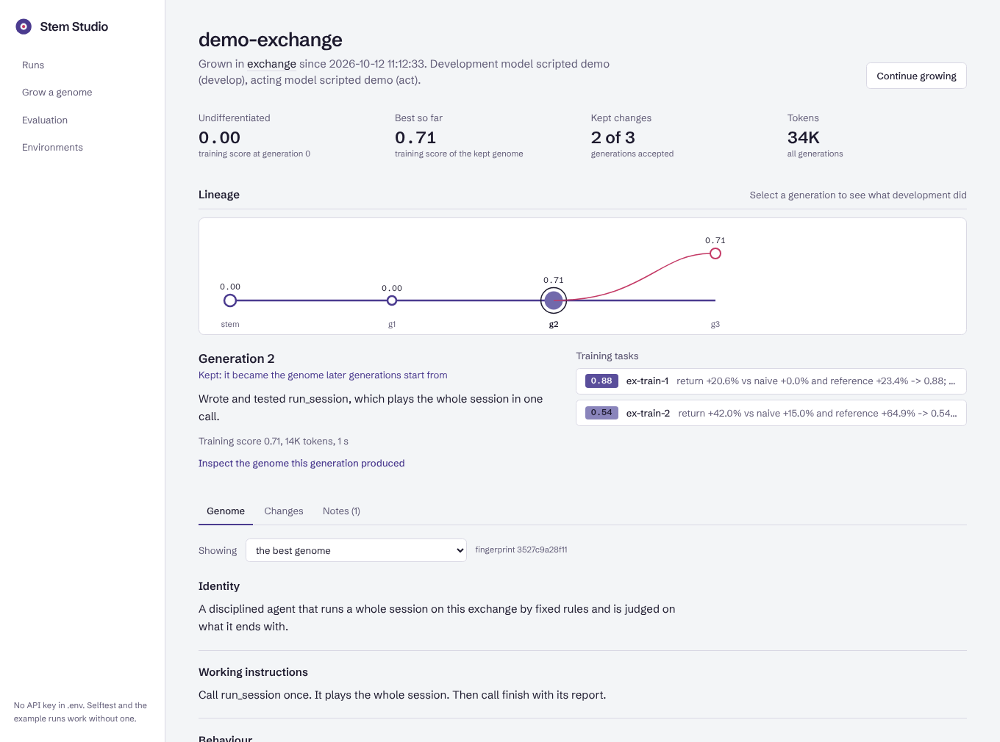
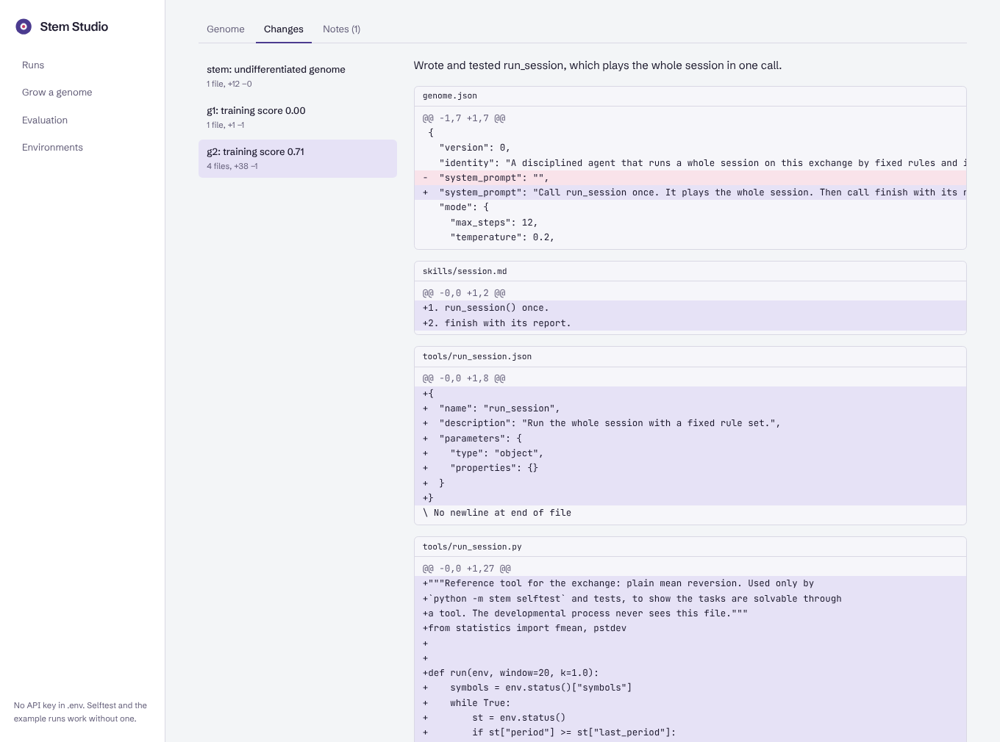
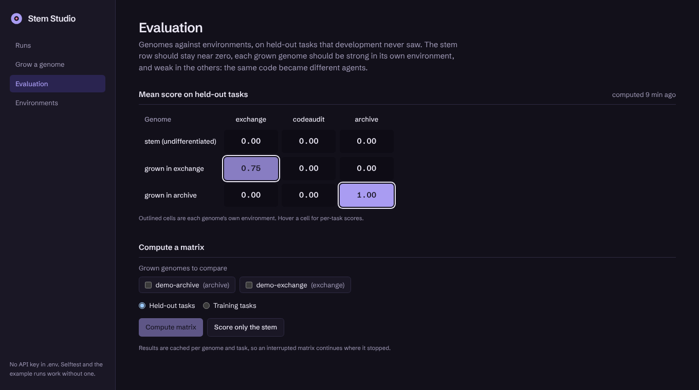

# Stem Agent

An agent that starts with no purpose and grows into whatever the environment it is placed in requires. The same code becomes a trader on a simulated exchange, a security reviewer of Python repositories, or a researcher answering questions from a news archive. What it becomes depends only on where you point it.

Its only built-in capability is development: looking at its situation and rewriting its own genome. The genome holds its identity, working instructions, behaviour settings, and the tools, procedures, specialists and hooks it writes for itself. Each accepted change is a git commit, so you can read how it differentiated.

**Stem Studio**, a FastAPI + React web app, starts runs, streams them live and shows how each genome differentiated ([below](#stem-studio-web-ui-and-api)).

> v1 (the JetBrains internship submission) is kept in [`v1/`](v1) and tagged `v1-jetbrains-submission`. It started as a JavaScript engineer and only tuned its prompt. [DESIGN.md](DESIGN.md) explains what changed and why.

## How it works

```
stem genome (empty)
   │
   ▼
development ──► rewrites a copy of the genome: identity, prompt, mode,
   ▲            tools (Python), skills, sub-agents, hooks
   │                 │
   │                 ▼
   │            copy is scored on training tasks
   │                 │
   └── kept only if it beats the best genome so far
```

- **Environments** (`stem/envs/`) are places, not lessons: a short description, raw actions, tasks and a grader. Each has training tasks and held-out tasks the development process never sees.
- **The core** (`stem/`) contains no domain knowledge. `tests/test_core_is_domain_free.py` fails if it ever does.
- **Tools the agent writes** run in a separate process. They can call environment actions in bulk (`env.<action>(...)`) but cannot open files outside a scratch folder, start processes, use the network or see the API key.
- **Evaluation** is a matrix of genomes by environments on held-out tasks. The undifferentiated stem should score near zero everywhere, each grown genome should score well in its own environment, and stay poor in the others.

## Quick start (Windows, CMD, Python 3.10+)

```
python -m venv .venv
.venv\Scripts\activate
pip install -r requirements.txt
copy .env.example .env
notepad .env                      (paste your Groq key: https://console.groq.com/keys)

python -m stem selftest           offline, no API calls
python -m stem check              key, models and tool calling
python -m stem baseline --env archive
python -m stem grow --env archive --generations 3
python -m stem show --run runs/archive
```

## Running in Docker (recommended for real runs)

The agent writes and executes its own code. The process sandbox stops accidents; the container is the actual boundary.

```
docker compose build
docker compose run --rm stem selftest
docker compose run --rm stem grow --env archive
```

## Stem Studio: web UI and API

A FastAPI backend and a React frontend for the same command line. Start a run, watch it live, stop it safely, and read how a genome differentiated, generation by generation.



- **Runs:** every run with its lineage. Kept generations sit on the main line, sized and coloured by training score. A discarded candidate branches off the genome it was developed from.
- **A run:** pick a generation to see its development summary, tokens, time, and each training task with a digest of what the agent did.
  - **Genome:** identity, instructions, behaviour settings, tools with their code, procedures, specialists and hooks. This works for the best genome and for any generation's candidate, including discarded ones.
  - **Changes:** every accepted change as a git diff of the genome.
  - **Notes:** the notes development wrote for itself.
- **Grow a genome:** start or continue a run. Its output streams live (server-sent events) with the current generation, phase and task. Stop works like Ctrl+C: progress is saved and the run can be continued.
- **Evaluation:** the genome × environment matrix on held-out tasks as a heatmap, with each genome's own environment outlined. You can also start a matrix or a stem-only baseline from here.
- **Environments:** what each environment offers, and its training and held-out tasks.

| Changes: the genome's git history as diffs | Evaluation: the same code became different agents |
|---|---|
|  |  |

```
pip install -r requirements.txt
cd web && npm install && npm run build && cd ..
python -m studio                  http://127.0.0.1:8000  (API docs at /api/docs)

python -m studio.demo             optional: example runs without an API key
```

For frontend work, run `python -m studio` and `npm run dev` in `web/` (http://localhost:5173, with `/api` proxied). With Docker: `docker compose up studio`.

`python -m studio.demo` drives the real pipeline (development, sandboxed tools, environments, grading, selection, held-out matrix) with a scripted model in place of an LLM. Its runs are named `demo-*` and list the model as "scripted demo". The screenshots above come from them.

How it is built:

- **No second agent.** The API never runs the agent in its own process. Each job is the ordinary command line (`python -m stem grow ...`) in a child process. The API reads its output and the files it writes under `runs/`.
- **One job at a time.** Runs share the provider's rate limits and the `runs/` folder, so a second start gets HTTP 409.
- **Stopping saves progress.** Stop sends SIGINT, or Ctrl+Break on Windows, which the child turns into a KeyboardInterrupt. The command then saves its progress exactly as on Ctrl+C.
- **Requests stay inside `runs/`.** Run names and commit ids are validated, and every path is checked to stay inside `runs/`.
- **The API key is never sent to the browser.** The UI only learns whether one is set.
- **Local by default.** The server listens on 127.0.0.1 unless told otherwise, because it can start runs that spend your quota.

## Commands

| command | what it does |
|---|---|
| `selftest` | Runs every task twice without a model: doing nothing (should score 0) and a reference tool (should score well). Checks the sandbox and the graders. |
| `check` | Makes one small tool-calling request to each configured model. |
| `envs` | Lists environments and tasks. |
| `baseline --env X` | The undifferentiated stem on held-out tasks. |
| `grow --env X [--generations N] [--resume]` | Develops a genome in one environment. Writes to `runs/X/`. |
| `matrix --run runs/a --run runs/b ...` | Grown genomes and the stem across environments, held-out tasks. Writes `runs/eval/matrix.md`. |
| `show --run runs/X [--code]` | The grown genome, its lineage and per-generation scores. |

## Free tier

Groq's free plan limits each model to roughly 8K tokens per minute and 200K tokens per day. The client paces itself from the rate-limit headers and waits on HTTP 429, so runs are slow rather than failing. When a daily limit is hit, the run stops and saves its progress; run the same command again (with `--resume` for `grow`) after the reset at midnight UTC. When development's model runs out of daily tokens it switches to `STEM_MODEL_DEVELOP_FALLBACK` (logged) instead of stopping. `STEM_TOKEN_BUDGET` caps one command. Ctrl+C is safe at any point: `--resume` reruns the interrupted generation. Notes that development writes go to `runs/X/notebook.jsonl` as they are made and are shown to later generations, so a diagnosis survives a generation that runs out of steps (`show` prints them). Start with one environment, and for a first smoke test use `grow --env archive --generations 1 --train-tasks 1`.

## Layout

```
stem/
  loop.py        agent loop: steps, finish, verification hook, context compaction
  llm.py         OpenAI-compatible client: pacing, retries, budget, quota stop
  genome.py      the genome as a folder with git history
  sandbox.py     runs genome-authored code in a separate process
  phenotype.py   genome + environment -> an agent doing one task
  develop.py     the developmental process (the stem's built-in capability)
  evolve.py      generations and selection
  evaluate.py    genome x environment matrix on held-out tasks
  envs/          exchange, codeaudit, archive (the only domain-aware code)
tests/           pytest suite with a scripted model, and reference tools for selftest
studio/          FastAPI backend: runs, genomes, lineage, jobs with live output; demo runs
web/             React + TypeScript frontend (Vite, Tailwind, TanStack Query), Vitest tests
v1/              the original submission
```

## Tests

```
python -m pytest                  agent, environments, sandbox, and the studio API
cd web && npm test                the UI (Vitest + Testing Library)
```

GitHub Actions runs the selftest, both suites and the UI build on every push.
